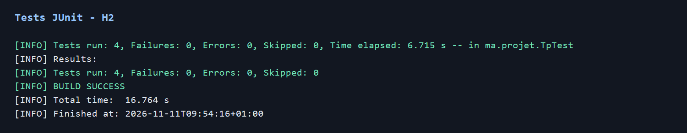
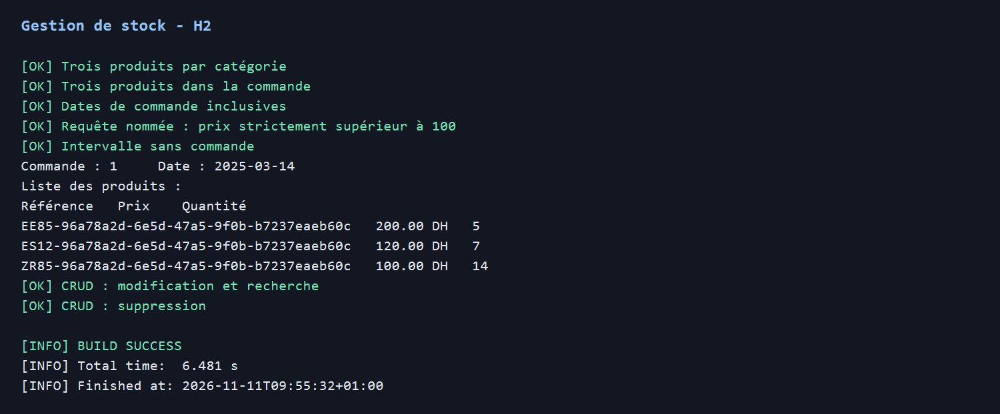
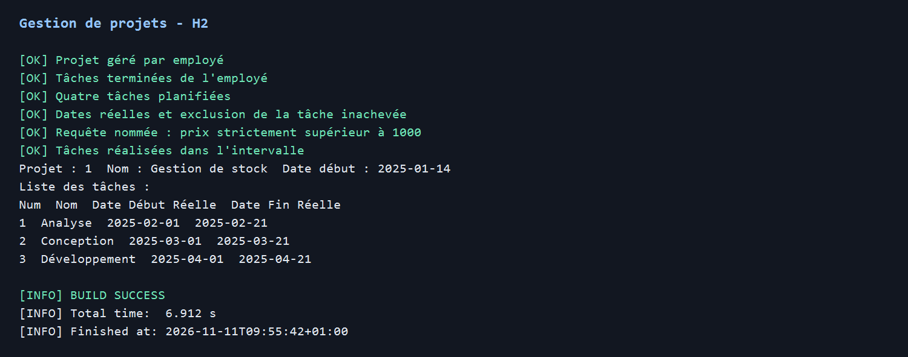
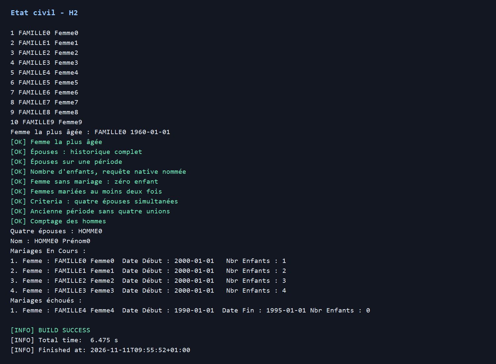
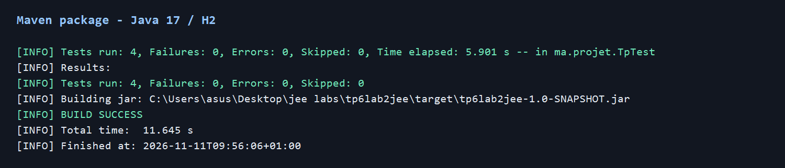

# TP 6 — Hibernate et JPA

Gestion de stock, gestion de projets et état civil dans un projet Maven.
Prérequis : JDK 17 minimum, Maven 3.9 et MySQL 8.

**Validation effectuée : compilation Java 17, quatre tests réussis sur H2, trois démonstrations réussies et génération du JAR avec Maven.**

MySQL est démarré, mais la connexion par défaut a été refusée pour root sans mot de passe. La validation MySQL reste à effectuer avec les identifiants locaux.
Les images ci-dessous sont des rendus des sorties console réellement enregistrées sur H2 ; leurs extraits texte sont conservés à côté des PNG dans docs/screenshots.

## Organisation

- `ma.projet.classes` : entités stock et projets.
- `ma.projet.beans` : Personne, Homme, Femme, Mariage ; héritage JPA JOINED.
- `ma.projet.dao.IDao<T>` : CRUD générique.
- `ma.projet.service` : services et requêtes métier.
- `ma.projet.util.HibernateUtil` : configuration Hibernate.
- `ma.projet.test.Demonstration` : programmes console.
- `TpTest` : tests JUnit des trois exercices.

Les associations LigneCommande, EmployeTache et Mariage utilisent un identifiant technique.
Les couples produit/commande et employé/tâche sont uniques. Les montants utilisent BigDecimal.

## Personnalisation

| Entité | Champs supplémentaires |
|---|---|
| Categorie | description |
| Produit | marque, stockMinimal |
| Commande | client, statut |
| LigneCommande | prixUnitaire conservé à la commande |
| Employe | email, specialite |
| Projet | budget, statut |
| Tache | priorite |
| EmployeTache | heuresPassees |
| Personne | cin unique, ville |
| Mariage | lieu |

## Fonctionnalités

| Service | Méthodes métier |
|---|---|
| ProduitService | produitsParCategorie, produitsCommandesEntre, produitsParCommande, afficherProduitsCommande, produitsPrixSuperieur100 |
| EmployeService | tachesRealisees, projetsGeres |
| ProjetService | tachesPlanifiees, tachesRealisees, afficherTachesRealisees |
| TacheService | prixSuperieur1000, realiseesEntre |
| HommeService | epouses, epousesEntre, afficherMariages |
| FemmeService | plusAgee, nombreEnfantsEntre, marieesAuMoinsDeuxFois, nombreHommesQuatreEpousesEntre |
| MariageService | parHomme, hommesQuatreEpousesEntre, afficherMariages |

Les services héritent tous du CRUD. Les listes peuvent être affichées dans la console.
Produit et Tache utilisent les requêtes nommées demandées ; Femme utilise une requête native nommée et une requête JPQL nommée ; le filtre quatre épouses utilise Criteria.

Les bornes des dates sont inclusives.
Les produits sont filtrés par date de commande.
Une tâche réalisée possède une date de fin réelle ; sa réalisation entre deux dates doit être entièrement comprise dans l'intervalle.
Les épouses sur une période correspondent aux unions qui chevauchent celle-ci.
Le filtre quatre épouses recherche exactement quatre femmes distinctes dont les unions couvrent **toute** la période : les quatre unions sont simultanées.
Le nombre d'enfants est la somme des enfants des mariages commencés dans l'intervalle ; le modèle ne contient pas les dates de naissance des enfants.
Un mariage est en cours si sa date de fin est absente.

## Comment tester avant GitHub

Toutes les commandes suivantes sont à lancer toi-même dans PowerShell à la racine du projet.

### 1. Outils et tests isolés

```powershell
$env:JAVA_HOME = 'C:\Program Files\Java\jdk-17'
$env:Path = "$env:JAVA_HOME\bin;$env:Path"
java -version
mvn -version
mvn clean test
```

Sur cette machine, Maven a nécessité le magasin de certificats Windows pour télécharger ses dépendances :

```powershell
$env:MAVEN_OPTS = '-Dfile.encoding=UTF-8 -Djavax.net.ssl.trustStoreType=Windows-ROOT -Djavax.net.ssl.trustStore=NONE'
```

Maven doit utiliser un JDK 17 ou supérieur. Dans IntelliJ, sélectionner aussi ce JDK pour le projet et Maven.
Les tests utilisent H2 en mémoire et ne nécessitent pas MySQL.
Les lancer dans un terminal sans variables DB_URL, DB_USER et DB_PASSWORD : ces variables remplacent la configuration de tous les profils.

Attendre BUILD SUCCESS et quatre tests sans échec. Les rapports sont dans target/surefire-reports.
Les scénarios vérifient le CRUD, les catégories, commandes, seuils stricts 100/1000, bornes de dates, tâche inachevée, dix femmes et cinq hommes, femme la plus âgée, épouses, enfants et unions simultanées.
H2 ne remplace pas la vérification sur MySQL.

### 2. Tests MySQL

Démarrer MySQL et utiliser un compte autorisé à créer la base et les tables, ou créer la base au préalable.

**Le profil de test MySQL crée puis supprime ses tables : utiliser exclusivement une base de test dédiée.**

```powershell
$env:DB_URL = 'jdbc:mysql://localhost:3306/tp6lab2jee_test?createDatabaseIfNotExist=true&serverTimezone=UTC'
$env:DB_USER = 'root'
$env:DB_PASSWORD = 'ton_mot_de_passe_local'
mvn '-Dtp.test.config=application-mysql-test.properties' test
```

Vérifier les quatre tests réussis, notamment la requête SQL native et Criteria.

### 3. Démonstrations

La configuration normale utilise update et conserve les données. Chaque lancement ajoute des données fictives ; les CIN et références sont uniques pour permettre les relances.

```powershell
$env:DB_URL = 'jdbc:mysql://localhost:3306/tp6lab2jee?createDatabaseIfNotExist=true&serverTimezone=UTC'
mvn compile exec:java '-Dexec.mainClass=ma.projet.test.Demonstration' '-Dexec.args=stock'
mvn exec:java '-Dexec.mainClass=ma.projet.test.Demonstration' '-Dexec.args=projets'
mvn exec:java '-Dexec.mainClass=ma.projet.test.Demonstration' '-Dexec.args=etat-civil'
```

Conserver DB_USER et DB_PASSWORD de l'étape précédente.
Dans IntelliJ, lancer aussi Demonstration.main avec l'argument tout et les mêmes variables d'environnement.
Vérifier les lignes [OK], les tableaux commande/projet et les groupes de mariages.
Dans MySQL, contrôler les tables, clés étrangères et champs supplémentaires.
Prendre les captures et les ajouter dans docs/screenshots.

Les démonstrations ont aussi été exécutées séparément avec H2, sans modifier la configuration MySQL :

```powershell
mvn '-Dtp.config=application-test.properties' exec:java '-Dexec.classpathScope=test' '-Dexec.mainClass=ma.projet.test.Demonstration' '-Dexec.args=stock'
mvn '-Dtp.config=application-test.properties' exec:java '-Dexec.classpathScope=test' '-Dexec.mainClass=ma.projet.test.Demonstration' '-Dexec.args=projets'
mvn '-Dtp.config=application-test.properties' exec:java '-Dexec.classpathScope=test' '-Dexec.mainClass=ma.projet.test.Demonstration' '-Dexec.args=etat-civil'
```

En cas d'erreur de connexion, vérifier le service MySQL, le port, les identifiants et les droits.
Pour relancer H2, utiliser un terminal sans variables DB_*.

### 4. Dépôt GitHub

Ne jamais mettre de mot de passe réel dans les fichiers : utiliser les variables d'environnement.
Les images des sorties sont incluses dans la section Captures, sans légende.
Vérifier une dernière fois le projet :

```powershell
mvn package
git init
git status
git add pom.xml src README.md .gitignore docs
git diff --cached
git commit -m "Réalisation du TP Hibernate"
```

Avant le commit, vérifier que target, les fichiers IDE et les secrets ne sont pas indexés.
Créer un dépôt GitHub vide puis remplacer ADRESSE_DU_DEPOT :

```powershell
git branch -M main
git remote add origin ADRESSE_DU_DEPOT
git push -u origin main
```

Si un dépôt ou un remote origin existe déjà, conserver sa configuration et adapter les commandes.

## Captures










